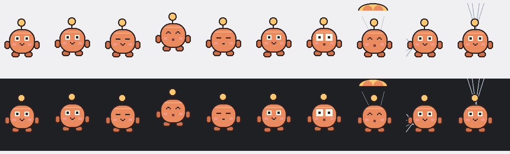

# Pip — a very small desk pet

A pixel sprite that lives on the bottom of your screen, wanders around on its
own, and reacts to you. One Python file, no Electron, no game engine, no
background service, no asset files.



| | |
|---|---|
| Idle memory | ~39 MB |
| CPU while walking | ~3.5% of one core |
| CPU while asleep | near zero |
| Startup | under a second |
| Dependencies | Python 3 + tkinter + Pillow |

Measured over an eight-second sample on a 12-core machine, with the pet walking
about half the time. That is roughly 0.3% of total CPU, and most of it is
Windows recompositing the borderless window as it moves.

---

## Run it

Double-click **`run.cmd`** (no console window), or:

```
pythonw deskpet.py
```

To have it start with Windows, run **`start-with-windows.cmd`** once. It drops a
shortcut in your Startup folder. Delete that shortcut to undo it.

## Controls

| Action | What happens |
|---|---|
| Click | Small hop, two hearts, a chirp |
| Double-click | Bigger hop, four hearts |
| Hover | Antenna perks, it stops and looks at you |
| Drag | Pick it up, it dangles with wide eyes |
| Throw it at a wall | It fires a web and sticks to the wall |
| Click while stuck | Drops off the wall |
| Drop it from high up | A little parachute opens and it floats down |
| Release low | Falls and lands with a squash |
| Right-click | Nap, wake, toggle wandering, toggle sound, reset position, quit |
| Leave it alone for a minute | It dozes off and floats little z's |

Throwing means releasing while the cursor is still moving fast — about 850 px/s.
A gentle drop from more than ~150 px opens the parachute instead. It unsticks
itself after 25 seconds if you forget about it.

Pupils follow your cursor whenever it is within a couple of hundred pixels.
Blinking is random, with occasional double blinks.

## Sound

Five sounds are synthesised at startup into memory — hop, land, web, parachute,
throw — so there are no `.wav` files to ship. They are deliberately quiet.
Right-click → **Sound** mutes them, and the choice is remembered.

## How it works

The art is a 32×32 pixel grid drawn with Pillow at 3–4× nearest-neighbour
upscale, so it stays crisp at any DPI and costs nothing to animate. Frames are
generated lazily and cached by state, so the loop mostly swaps a cached
`PhotoImage` rather than redrawing.

Transparency uses a Windows colour key (`#0a0a0a`), which is why the palette has
no near-black except the outline. The window is borderless, always on top, and
moves itself along the work area above the taskbar.

Movement and animation are ticked at three rates: 40 ms while flying, falling or
being dragged, 70 ms while walking, and 110 ms when idle. Only walking and
physics move the window; an idle pet is just a cached image swap.

## Tuning

Everything lives at the top of `deskpet.py`:

- `BODY`, `BODY_DARK`, `BODY_LIGHT`, `ACCENT` — the palette; change these to recolour it
- `3.2` in `self.p` — sprite scale (bigger number, bigger pet)
- `34.0` in the `walk` branch — walking speed, px per second
- `60` in `tick` — seconds of no attention before it naps
- `0.52` — chance it decides to walk instead of hop or look around
- `850` in `_release` — how hard you have to throw for it to hit a wall
- `150 * self.ui` in `_release` — drop height that opens the parachute

The saved position and mute state live in `%APPDATA%\PipDeskPet\state.json`.

## Known limits

- Primary monitor only.
- The colour-key transparency means it has no soft drop shadow.
- It is topmost, so it will sit above most windows.
- Web strands are drawn inside the pet's window, so they reach the screen edge
  rather than any window edge.
